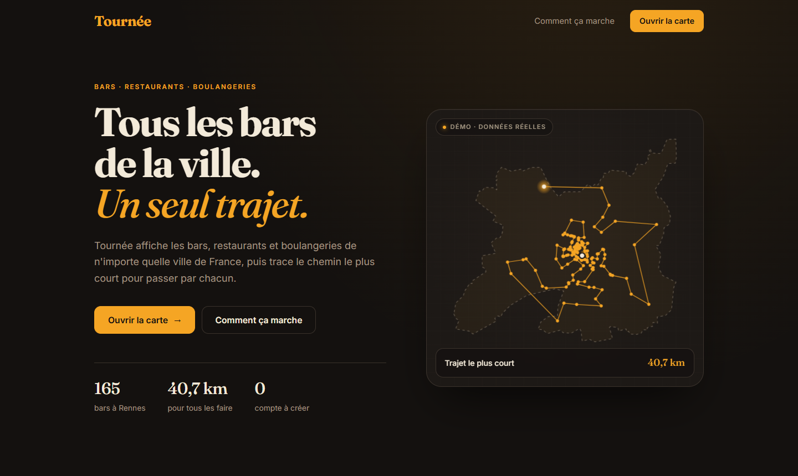
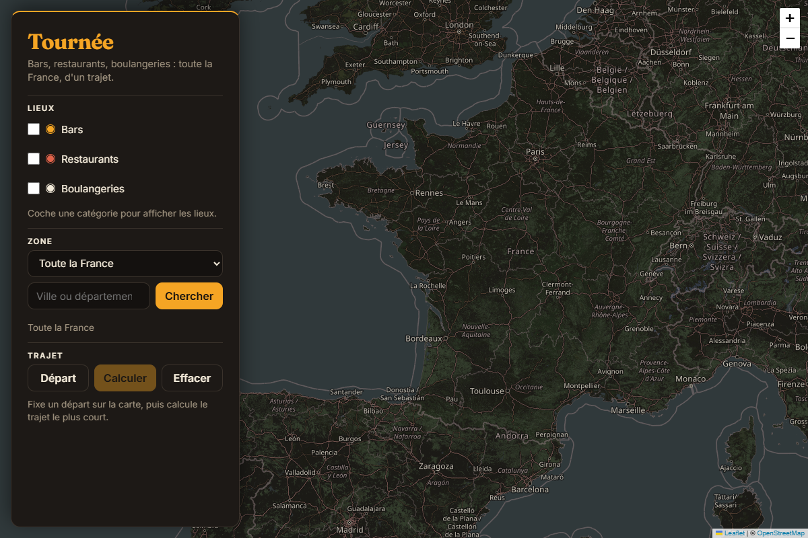
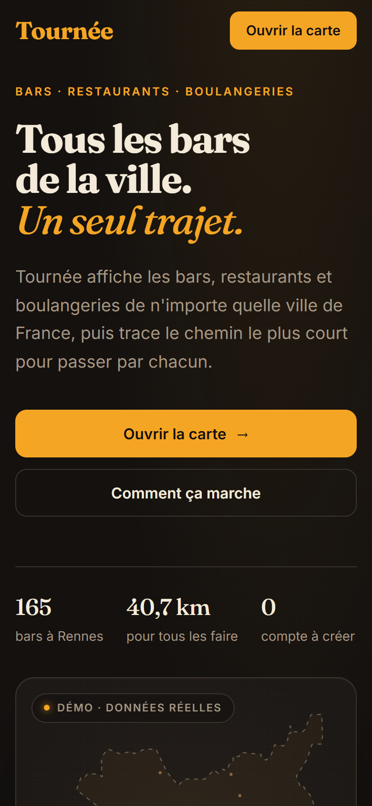

# Tournée · Tous les bars de la ville, un seul trajet

🌐 **[tournee.projectp.fr](https://tournee.projectp.fr/)**

**Tournée** est une carte de France des **bars**, **restaurants** et **boulangeries**. On choisit ses catégories et une zone (toute la France, une région, une ville ou un département), puis on clique un point de départ : Tournée calcule **l'ordre de passage le plus court** pour faire tous les lieux affichés, et le trace sur la carte.

Projet du **jour 27** du défi **30 jours, 30 projets** (TypeScript, Vite, Leaflet, OpenStreetMap).

[](https://tournee.projectp.fr/)

<p align="center">
  
  
</p>

## Le scénario

> **Rennes · 165 bars**
> Départ place de la République · trajet le plus court : **40,7 km** à vol d'oiseau

1. Sur la carte, coche **Bars** (et, si tu veux, Restaurants et Boulangeries).
2. Choisis une **zone** : une région dans le menu, ou n'importe quelle ville ou département avec la recherche.
3. Les lieux s'affichent, une couleur par catégorie. Un clic sur un marqueur donne le nom et l'adresse.
4. Clique **Départ**, puis un point sur la carte, puis **Calculer**.
5. Le trajet apparaît en pointillés, avec le nombre de lieux et la distance totale.

## Fonctionnalités

- **Landing** (`/`) : héro animé où la carte de France se dessine, zoome sur Rennes, fait apparaître ses 165 bars puis trace le trajet le plus court qui les relie, compteur de kilomètres compris. Données réelles d'OpenStreetMap, figées dans `src/hero-data.ts`. Image fixe si le système demande moins d'animations.
- **Carte** (`/carte/`) : carte plein écran, panneau à gauche sur ordinateur et en bas sur téléphone.
- **3 catégories** : bars (`amenity=bar|pub`), restaurants (`amenity=restaurant`), boulangeries (`shop=bakery`).
- **Zones** : toute la France, 13 régions, ou recherche libre de ville ou de département. Les lieux hors zone sont masqués.
- **Trajet ouvert** (sans retour au départ) jusqu'à **1000 lieux**, calculé dans le navigateur.
- **Cache** : les lieux déjà chargés sont gardés 7 jours dans le navigateur (IndexedDB), par cellules d'environ 5 × 4 km.

## Le trajet le plus court

Faire tous les lieux par le chemin le plus court, c'est le problème du voyageur de commerce : impossible à résoudre exactement pour des centaines de points. Tournée utilise deux méthodes classiques, en local :

1. **Plus proche voisin** : depuis le départ, on va toujours au lieu le plus proche pas encore visité.
2. **2-opt** : tant que deux tronçons du trajet se croisent, on inverse le passage entre eux, ce qui raccourcit le trajet. Arrêt quand plus rien ne s'améliore, ou après 1,5 s.

Le résultat est en général à quelques pour cent du meilleur trajet possible. 1000 points aléatoires se calculent en environ 0,5 s. Les distances sont **à vol d'oiseau** (formule de haversine), le tracé est en lignes droites.

## Critères de réussite

| Critère | État |
|---|:---:|
| Afficher bars, restaurants et boulangeries sur une carte de France | ✅ |
| Restreindre à une zone : une région (ex. Bretagne) ou une ville (ex. Paris) | ✅ |
| Trajet le plus court qui passe par tous les lieux affichés | ✅ plus proche voisin + 2-opt |
| Rester utilisable quand un serveur Overpass est saturé | ✅ trois miroirs + cache |
| Landing de présentation avec héro animé | ✅ |

Pas fait : trajet sur les vraies routes, export du trajet, départements dans le menu (ils passent par la recherche).

## Stack

TypeScript · Vite (deux pages : landing et carte) · Leaflet · OpenStreetMap (Overpass pour les lieux, Nominatim pour les zones) · IndexedDB · Nginx dans Docker, hébergé sur Coolify.

Interface : Fraunces et Inter, palette `#14110F` / `#F5A524` / `#F3EAD9`.

## Lancer en local

Prérequis : Node.js 22+.

```bash
npm install
npm run dev        # landing sur http://localhost:5173, carte sur /carte/
npm test           # trajet (route.ts) et découpage du cache (places.ts)
npm run build      # vérification TypeScript puis build dans dist/
```

Pour régénérer les données du héro (contours de la France et de Rennes, bars de Rennes, ordre du trajet) :

```bash
node scripts/hero-data.ts
```

## Déploiement

`Dockerfile` en deux temps : build Vite, puis fichiers statiques servis par Nginx (port 80, `nginx.conf`). Les fichiers hachés de `/assets/` sont gardés un an en cache, les pages HTML jamais. Une instance est en ligne sur Coolify : **tournee.projectp.fr**.

## Structure

| Fichier | Contenu |
|---|---|
| `index.html`, `src/landing.ts`, `src/landing.css` | Landing et animation du héro |
| `src/hero-data.ts` | Données du héro, générées par `scripts/hero-data.ts` |
| `carte/index.html`, `src/main.ts`, `src/style.css` | La carte et son panneau |
| `src/places.ts` | Requêtes Overpass, miroirs de repli, découpage en cellules |
| `src/cache.ts` | Cache IndexedDB (7 jours) |
| `src/zones.ts` | Régions et recherche Nominatim |
| `src/route.ts` | Plus proche voisin, 2-opt, distances |
| `docs/` | Captures de ce README |

Le journal de bord complet (demandes, décisions, essais, échecs) est dans [`CLAUDE_CONTEXTE.md`](CLAUDE_CONTEXTE.md).

## Limites

- Les lieux dépendent des serveurs Overpass publics, parfois saturés : un message « service indisponible » s'affiche alors. Le miroir principal (`overpass.openstreetmap.fr`) a des données de mi-septembre 2026.
- Le trajet est à vol d'oiseau, pas sur les routes : la vraie distance à pied est plus longue.
- Tuiles, recherche et lieux viennent de services publics gratuits, qui ne conviennent pas à un fort trafic.

## Crédits

- **Données et fond de carte** : © [contributeurs OpenStreetMap](https://www.openstreetmap.org/copyright), licence ODbL.
- **Carte** : [Leaflet](https://leafletjs.com/).
- **Polices** : [Fraunces](https://fonts.google.com/specimen/Fraunces) et [Inter](https://fonts.google.com/specimen/Inter) (Google Fonts).
